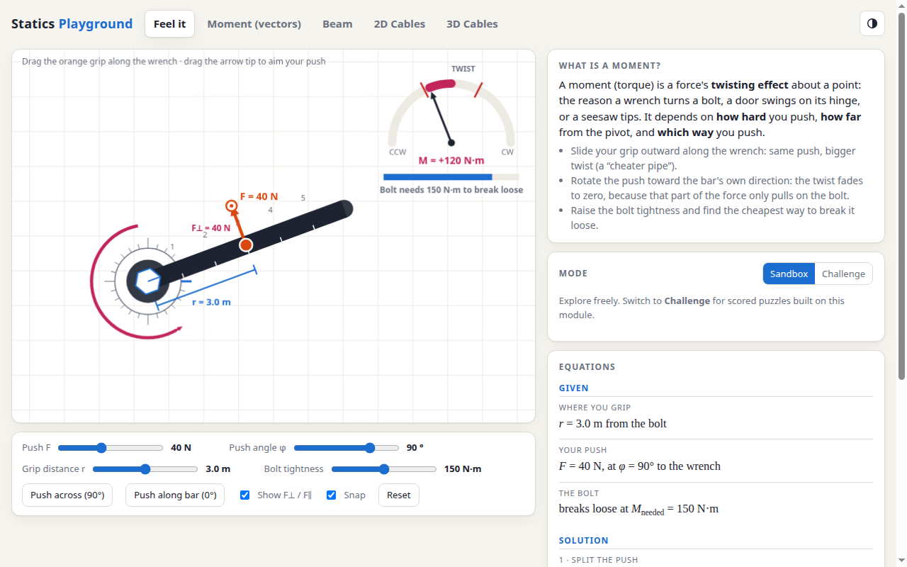

# Statics Playground

An interactive, single-file web playground for learning introductory engineering statics. Drag the forces, watch the equations and diagrams update live, and test yourself in Challenge mode.



## Modules

- **Feel it**: build intuition for moments with a wrench and a stubborn bolt.
- **Moment (vectors)**: moment of a force about a point, M = F·d.
- **Beam**: beam equilibrium with support reactions plus shear and moment diagrams.
- **2D Cables**: particle equilibrium of a knot held by two cables.
- **3D Cables**: three-cable tension in 3D, solved as a 3×3 linear system.

Each module has a **Sandbox** mode for free exploration and a **Challenge** mode with scored puzzles and streaks. Light and dark themes are supported.

## Run it

No build step and no dependencies. Open `index.html` in a browser:

```bash
xdg-open index.html
# or serve it locally
python3 -m http.server 8000
```

## Project layout

- `index.html`: the whole app (HTML, CSS and JavaScript in one file)
- `docs/`: README assets
